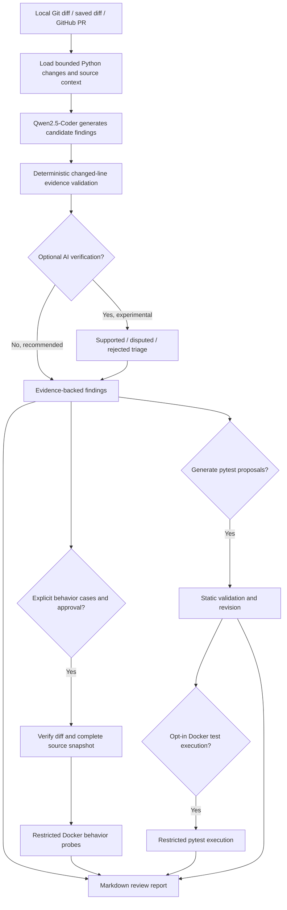

AI-Powered Code Review & Test Generation Agent
A local-first AI developer tool that reviews Python code changes, proposes pytest tests, and supports evidence-backed validation in Docker.

Built with: Python · LangGraph · Ollama · Qwen2.5-Coder · Pydantic · pytest · Docker · GitHub REST API

Quick start · How it works · Demonstration · Evaluation · Safety
Why this project?
AI-assisted code review can be useful, but a plausible-sounding warning is not necessarily a real defect. This project explores how to make local-LLM reviews more traceable and testable rather than treating model output as ground truth.

The agent analyzes Python Git diffs or GitHub pull requests, produces structured findings with exact changed-line evidence, and can generate pytest proposals. Optional, explicitly approved Docker workflows execute tests or compare the behavior of old and new code on selected inputs.
What it does
Capability	Implementation
AI code review	Qwen2.5-Coder through Ollama, orchestrated with LangGraph
Evidence-backed findings	File, severity, line, quoted changed code, explanation, suggested fix
Evidence validation	Deterministic diff matching and unambiguous line-number recovery
GitHub pull requests	Read-only GitHub REST API integration for Python changes
AI-generated tests	Proposed pytest tests with static validation and bounded revision attempts
Docker test execution	Opt-in execution of generated tests in restricted containers
Behavior comparison	Opt-in Docker probes comparing old/new function results and exceptions
Review triage	Optional experimental second-pass verifier, with disputed and rejected findings retained for inspection
Evaluation and CI	Labeled benchmarks, repeated runs, and GitHub Actions on Python 3.12/3.13

Project status: The core development workflow is implemented and locally validated. It is a research/portfolio tool, not a production security scanner or correctness proof. The second AI verification pass is experimental and is not the recommended default.

Quick start
Requirements
- Python 3.12 or 3.13 and Git
- Ollama installed and running locally
- Optional: Docker Desktop with Linux containers, for executing generated tests or behavior probes
On Windows PowerShell:
git clone https://github.com/GulshanK25/github-code-review.git
cd github-code-review
python -m venv .venv
.\.venv\Scripts\Activate.ps1
python -m pip install -r requirements.txt
ollama pull qwen2.5-coder:7b
python -m pytest -q
Make sure the Ollama service is running before attempting an AI review. Basic unit tests do not require an Ollama server or Docker.
Review a local diff
python main.py --diff-file examples\sample.diff --repo examples\sample_project --model qwen2.5-coder:7b --review-mode evidence
Review a GitHub pull request
python main.py --pr-url "https://github.com/GulshanK25/github-code-review/pull/1" --model qwen2.5-coder:7b --review-mode evidence
PR review is read-only. Public PRs generally work without a token; private repositories may need a read-only GITHUB_TOKEN. The tool does not post comments or merge pull requests.

The default report is saved to review_report.md; customize the path with --output.
Demonstration
A sample authorization change replaces an administrator-role check with a Python truthiness check:
- return user.get("role") == "admin"
+ return bool(user)
The resulting review identified the issue and referenced the correct changed line:
HIGH | auth.py:4
Issue: A non-empty non-admin user dictionary can pass the authorization check.
Changed-line evidence: return bool(user)
Suggestion: Restore the administrator role check.
After explicit approval, Docker behavioral probes compared the two implementations:
Behavioral comparison: completed
Probes executed: 3
Different outcomes: 2
Related finding: auth.py:4
These are observations from the demonstrated test case, not proof that a change is buggy in every context. Full generated reports vary with the model.

To reproduce the Docker demonstration:
docker build -f Dockerfile.test-runner -t ai-code-review-pytest:local .
python main.py --diff-file examples\behavior_review\auth.diff --repo examples\behavior_review --model qwen2.5-coder:7b --review-mode evidence --behavior-cases examples\behavior_review\cases.json --execute-behavior-in-docker --output review_behavior_demo.md
Docker Desktop must be running. This command executes only the explicitly supplied behavioral probes in a restricted container. Normal PR review never runs repository code automatically.

See the [five-minute demo guide](docs/DEMO.md) for a complete walkthrough.
How it works

Key design choices:
- The LLM proposes findings; a separate deterministic validator checks whether each quoted line is actually in the diff. A valid location does not prove the diagnosis is correct.
- An incorrect line number is recovered only when the quoted line uniquely identifies a changed line.
- The optional second AI verifier does not run by default because it suppressed genuine findings during evaluation.
- Behavioral probes require explicit local inputs and approval. The system refuses execution when the approved code cannot be matched to the review inputs.
- Findings, disputed candidates, and behavioral observations remain distinct so that uncertainty is visible.
Other commands
Generate pytest proposals
python main.py --diff-file examples\sample.diff --repo examples\sample_project --model qwen2.5-coder:7b --generate-tests --tests-output generated_tests\test_proposal_v1.py
Add --auto-test to execute generated tests in Docker (Docker must be running and the test-runner image built). Generated tests require manual review and can deliberately fail when they detect a regression. Use a new output filename for each run.

An optional --contract behavior_contract.json (resolved within --repo) supplies expected behaviors independently of AI-generated tests.
Standalone behavior benchmark
python -m benchmarks.behavior_compare --execute-in-docker --only holdout_safe_demorgan
python -m benchmarks.behavior_compare --execute-in-docker --only holdout_session_expiry_reversal
Evaluation and results
We used a separate 12-case, hand-authored holdout dataset containing six labeled buggy and six labeled safe Python changes. Evidence-only review was repeated three times with the same model and machine.
Case-level metric	Evidence-only, each of 3 runs	Optional second AI verifier, 1 run
True positives	6	1
False positives	3	1
False negatives	0	5
True negatives	3	5
Precision proxy	66.7%	50.0%
Recall proxy	100.0%	16.7%
False alarm rate	50.0%	16.7%

Evidence-only had zero case-classification changes across the three runs. That shows repeatability on these examples, not general reliability. In particular, the model also repeatedly flagged three labeled safe refactorings. This limitation motivated the optional behavioral comparison component.

These scores are small-dataset, case-level proxies. They do not establish production precision, recall, security coverage, or general performance on real-world PRs. The second model pass remains experimental because it rejected many genuine benchmark findings.

Reproduce the holdout benchmark (requires Ollama):
python -m benchmarks.holdout_compare --model qwen2.5-coder:7b --mode evidence --repeats 3
python -m benchmarks.holdout_compare --model qwen2.5-coder:7b --mode both --repeats 1
Generated evaluation outputs are written to benchmarks/results/ and should not be committed if they contain private data.
Testing and CI
The final integration was validated locally with 149 passing automated tests. GitHub Actions runs the application unit tests for Python 3.12 and 3.13 on pull requests and pushes to main.
python -m pytest -q
CI is intentionally independent of Ollama and Docker. Its test results validate application logic and integration boundaries, not the factual accuracy of AI findings.

View GitHub Actions · [Release checklist](docs/RELEASE_CHECKLIST.md)
Repository structure
Path	Responsibility
main.py	Command-line interface and explicit execution flags
agent/workflow.py	LangGraph orchestration
agent/llm.py	Ollama review and test-generation prompts
agent/github_utils.py	Read-only GitHub PR retrieval
agent/review_quality.py	Diff/evidence validation and line recovery
agent/verification_quality.py	Experimental second-pass consistency rules
agent/behavior_integration.py	Approval, diff/snapshot matching, and report enrichment
agent/behavior_sandbox.py	Restricted Docker behavior comparison
agent/sandbox.py	Docker execution of generated pytest proposals
benchmarks/	Development/holdout cases and evaluators
tests/	Unit and workflow tests
docs/	Demo walkthrough and release checklist
.github/workflows/ci.yml	CI test matrix

Security and limitations
- Do not treat AI findings as verified bugs. The model can hallucinate and miss real security problems.
- Generated tests can be incorrect or misleading and may need revision or manual assessment.
- Docker isolation reduces exposure but is not a perfect sandbox. Do not run privileged containers, share secrets, or mount sensitive directories when executing untrusted code.
- A behavioral difference can be intentional. A match on selected inputs is not proof of program equivalence, and these probes do not cover every side effect or input.
- PR source context is deliberately bounded; files may be excluded by size limits. The resulting review may be incomplete.
- The optional AI verification mode can be overly conservative. It is retained for research and human triage, not as the default correctness gate.
Project links
Repository: github.com/GulshanK25/github-code-review

Demo: [DEMO.md](docs/DEMO.md) · Release notes/checklist: [RELEASE_CHECKLIST.md](docs/RELEASE_CHECKLIST.md)