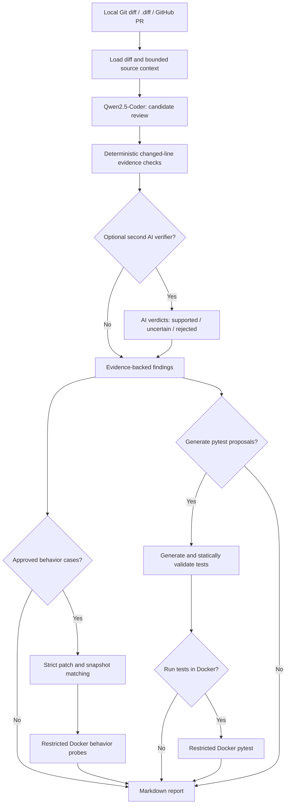

# AI-Powered Code Review and Test Generation Agent

A local-first Python software engineering project that reviews Git diffs and GitHub pull requests with **Ollama + Qwen2.5-Coder**, validates code evidence, proposes pytest tests, and optionally executes tests or approved behavior comparisons inside restricted Docker containers.

**Stack:** Python · LangGraph · Ollama · Qwen2.5-Coder · Pydantic · pytest · Docker · GitHub API

> **Project status:** Core functionality and evaluation tooling implemented. The second AI verification pass remains **experimental**, because it missed real bugs in our benchmark. Behavioral comparison is an **opt-in** supplement, not a correctness oracle. See [Evaluation](#evaluation-results) and [Safety](#safety-and-limitations).

## Features

- Review **local tracked Python changes**, a saved `.diff`, or a GitHub PR URL through the read-only GitHub API.
- Generate structured review findings with **file, line, exact changed-line evidence, severity, and suggested fix**.
- Check that the quoted evidence really matches a changed line. Correct an incorrect line number only when the quote uniquely matches the diff.
- Optionally have a second model pass challenge findings; keep **uncertain and rejected candidates visible** in the audit trail. This mode is experimental.
- Generate pytest proposals using changed source context and optional explicit behavioral contracts; revise static test-generation errors up to twice.
- Optionally execute generated tests in Docker, separately from the local Python interpreter.
- Optionally compare old/new function behavior on explicitly supplied JSON inputs **in Docker only**, after confirming the cases match the reviewed diff and complete new-source snapshot.
- Run two labeled benchmark sets (8 development cases + 12 holdout cases), repeat reviews, and save case-level results.
- Run application unit tests in GitHub Actions without calling Ollama, GitHub APIs, or Docker.

## Architecture



## Prerequisites

1. Python 3.12 or 3.13, Git, and Windows PowerShell (or an equivalent shell).
2. [Ollama](https://ollama.com/) running locally; install a coding model with `ollama pull qwen2.5-coder:7b`.
3. **Optional:** Docker Desktop in Linux-container mode for `--auto-test`, standalone behavior benchmarks, and opt-in behavior comparisons. Basic review and unit tests do not require Docker.

### Install (Windows PowerShell)

```powershell
cd C:\path\to\github-code-review
python -m venv .venv
.\.venv\Scripts\Activate.ps1
python -m pip install -r requirements.txt
ollama list
python -m pytest -q
```

If Docker-based execution is needed, start Docker Desktop and build the local runner image:

```powershell
docker build -f Dockerfile.test-runner -t ai-code-review-pytest:local .
```

## Usage

### Review a local `.diff`

```powershell
python main.py --diff-file examples\sample.diff --repo examples\sample_project --model qwen2.5-coder:7b --review-mode evidence
```

### Review a real GitHub pull request

```powershell
python main.py --pr-url "https://github.com/GulshanK25/github-code-review/pull/1" --model qwen2.5-coder:7b --review-mode evidence
```

GitHub PR mode makes **read-only** GitHub API requests. Public PRs generally work without a token; private repositories may require a read-only `GITHUB_TOKEN`. The agent does **not** post comments or merge PRs.

### Generate and optionally execute pytest proposals

```powershell
python main.py --diff-file examples\sample.diff --repo examples\sample_project --model qwen2.5-coder:7b --generate-tests --tests-output generated_tests\test_proposal_v1.py
```

Add `--auto-test` only after Docker is running. Use a fresh output filename on subsequent runs. Generated tests are proposals that need manual review; failing assertions can be desirable when testing deliberately buggy code.

### Behavioral comparison integrated into the main review

An **explicit local case file** is required. It includes before/after function source and JSON inputs. The system checks that its changed lines match the current review diff and that its new source matches the complete loaded new-file snapshot. Mismatches are *skipped* before Docker executes any code; the CLI returns a nonzero exit status if any approved check could not run.

```powershell
python main.py --diff-file examples\behavior_review\auth.diff --repo examples\behavior_review --model qwen2.5-coder:7b --review-mode evidence --behavior-cases examples\behavior_review\cases.json --execute-behavior-in-docker --output review_behavior_demo.md
```

The report adds a **Behavioral comparison** section with observed differences, case status, and linked changed-line findings where available. Behavior results never automatically approve or suppress AI findings. It does **not** automatically run for GitHub PRs. Using `--pr-url` with these flags requires a matching, user-approved local cases file and a complete source snapshot; unverified cases are skipped.

Run behavioral probes *without the LLM* for the standalone holdout dataset:

```powershell
python -m benchmarks.behavior_compare --execute-in-docker --only holdout_safe_demorgan
python -m benchmarks.behavior_compare --execute-in-docker --only holdout_session_expiry_reversal
```

## Evaluation results

We evaluated the evidence-based review on **12 hand-authored holdout examples** (6 labeled buggy, 6 labeled safe), repeated three times on the same machine and model:

| Metric (case-level proxy) | Evidence-only | Experimental AI verifier, one run |
|---|---:|---:|
| True positives | 6 | 1 |
| False positives | 3 | 1 |
| False negatives | 0 | 5 |
| True negatives | 3 | 5 |
| Precision | 66.7% | 50.0% |
| Recall | 100.0% | 16.7% |
| False alarm rate | 50.0% | 16.7% |

Evidence-only produced identical **case classifications** in all three runs. These are limited fixture-level observations, not real-world performance claims. Line-evidence validation does not prove a finding correct; benchmark labels and small sample size limit inference.

To reproduce evaluation (Ollama required):

```powershell
python -m benchmarks.holdout_compare --model qwen2.5-coder:7b --mode evidence --repeats 3
python -m benchmarks.holdout_compare --model qwen2.5-coder:7b --mode both --repeats 1
```

Results are written under `benchmarks/results/`; keep them out of source control if they contain private code or probe inputs.

## Tests and CI

```powershell
python -m pytest -q
```

GitHub Actions `.github/workflows/ci.yml` runs the handwritten test suite under Python 3.12 and 3.13 on pushes/PRs to `main`. No Ollama server, GitHub PR access, Docker daemon, or AI-generated code execution is needed in CI. This CI test suite checks application logic; it does not prove that AI findings are factually correct.

## Project layout

| Path | Purpose |
|---|---|
| `main.py` | CLI entry point and execution opt-ins |
| `agent/workflow.py` | LangGraph review, validation, test generation, and reporting nodes |
| `agent/llm.py` | Structured Ollama prompts and result parsing |
| `agent/review_quality.py` | Diff-grounded line evidence checks |
| `agent/verification_quality.py` | Experimental second-pass consistency checks |
| `agent/behavior_integration.py` | Explicit case loading, patch/snapshot matching, report annotations |
| `agent/behavior_sandbox.py` | Restricted Docker behavior comparisons |
| `agent/sandbox.py` | Docker execution of AI-generated pytest code |
| `benchmarks/` | Labeled case datasets and evaluation utilities |
| `tests/` | Handwritten unit tests (mock external services) |
| `.github/workflows/ci.yml` | CI tests on pull requests |

## Safety and limitations

- AI output is untrusted. This tool is **not** a security scanner or correctness proof. Human review remains required.
- The coding model may hallucinate defects and miss real vulnerabilities. The second AI verifier is optional and currently **not** recommended as a quality gate.
- Docker reduces risk but is **not** a perfect security boundary. Never run privileged Docker containers, give containers secrets, or mount an entire private repository for untrusted code.
- Behavior probes are selected manually. Comparing JSON values and exception types cannot capture all state changes, network effects, or behavior on untested inputs. A behavior change might be intended.
- When a complete source snapshot or exact changed-line evidence is unavailable, behavior execution is skipped rather than guessing.
- Test generation can produce invalid or misleading assertions. Sandboxed execution results need interpretation.

See [Demo walkthrough](docs/DEMO.md) and [Release checklist](docs/RELEASE_CHECKLIST.md) for a reproducible portfolio demonstration and merge steps.
